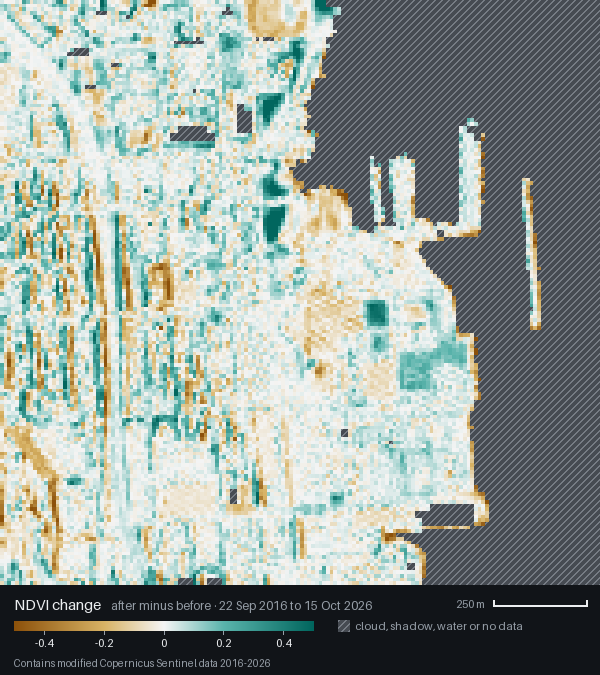

# Terragent

**Ask about any place on Earth, or we'll come to you with the answer.**

Built at the Naïve Autonomous Company Hackathon at YC (November 7 to 8, 2026).

> **Live:** https://terragent.vercel.app
>
> **Mission control:** https://terragent.vercel.app/dashboard
>
> **Demo:** https://terragent.vercel.app/demo

## The problem

Did this property flood? Is this supplier's land deforested? Is this mine expanding? The answers exist in satellite data, behind dozens of providers, accounts, minimum orders, licenses and analysts. Getting one takes days to weeks and costs hundreds to thousands of dollars, so only large contracts have ever made sense.

## What Terragent does

Terragent is an Earth intelligence company run by twelve AI agents. You send a place and a question through the portal, by email to `terragent@agentmail.to`, or through the API. Every answer goes through four steps:

1. **Investigate.** One agent screens the request for misuse. A planner turns it into a data spec and checks what the company already knows about that place. An acquisition agent tries free satellite data first and compares paid providers. This step costs the customer nothing.
2. **Quote.** A pricing agent builds one to three options, and our server recalculates each price so no agent can invent one. Work stops here until the customer accepts an option.
3. **Analyze.** A Python pipeline reads the imagery, masks clouds and measures change. An interpreter agent writes the answer from those measurements.
4. **Verify.** A separate agent grades the report and can send it back up to twice. Only a passing report reaches the customer, in the same email thread where they asked.

Terragent also finds its own customers. A sourcing agent watches public feeds for floods, fires, forest-loss alerts and new mining claims, matches each event to the businesses it affects, and runs a free analysis of that business's own asset before anyone asks.

```
 portal / email / API ─────────▶ screen → plan → compare data sources → quote
                                                                          │
 public feeds ─▶ match businesses ─▶ free sample ─┐              customer accepts
                                                  ▼                       ▼
                                        analyze → write report → verify (or revise)
                                                                          │
                                  Earth index ◀── delivered in the same thread
```

### What a customer sees

We asked Terragent how the neighborhood around YC's San Francisco office changed in ten years. This is the real pipeline output for that question, which you can replay at [/demo](https://terragent.vercel.app/demo).

| September 2016 | October 2026 | Vegetation change |
|---|---|---|
|  |  |  |

An API client asks, and gets a request ID back at once:

```jsonc
// POST /api/answer
{ "question": "How has the area around the YC office changed over the past ten years?",
  "location": "Y Combinator, 580 20th Street, San Francisco" }
// → 202
{ "request_id": "req_…", "status": "received", "status_url": "https://terragent.vercel.app/api/answer/req_…" }
```

Polling the status URL returns priced options and a ready-made call to accept one:

```jsonc
{ "request_id": "req_…", "status": "quoted", "done": false,
  "quote": {
    "recommended_option_id": "A",
    "options": [
      { "option_id": "A", "label": "Standard: 10 m public satellite data", "price_usd": 29, "delivery_time": "usually within a few hours of accepting" },
      { "option_id": "B", "label": "Sharper: 1 m archive imagery", "price_usd": 34, "delivery_time": "about 2–5 business days after you accept" },
      { "option_id": "C", "label": "New capture: 1 m imagery taken for you", "price_usd": 170, "delivery_time": "about 1–3 weeks after you accept" }
    ],
    "accept": { "method": "POST", "url": "https://terragent.vercel.app/api/quotes/accept", "body": { "token": "…", "option_id": "A" } } } }
```

After acceptance and verification, the same URL returns the answer, along with what it can't tell you:

```jsonc
{ "request_id": "req_…", "status": "delivered", "done": true,
  "report": {
    "url": "https://terragent.vercel.app/r/…",
    "answer": "Yes, visibly. … 0.19 km² of the 2.45 km² area changed past our threshold. The clearest change is on the waterfront southeast of the office, where the round storage tanks and open yards of 2016 are gone and large new roofs appear.",
    "confidence": "medium",
    "limitations": "Sentinel-2 pixels are 10 m, so this shows block-scale change, not individual buildings or what they are used for. …",
    "human_review_recommended": false } }
```

## Why it is built this way

- **Run by agents.** Twelve agents on one Naïve team, with a shared board and seven cron jobs covering signal sweeps, company reviews, site monitoring, follow-ups and market research. A coordinator measures results and moves effort between markets.
- **Rules live in code.** Agents hold no database, email or data-provider keys. They call 56 narrow tools on our own MCP gateway, each agent with its own token, and the server refuses anything the catalog doesn't grant that agent. Price checks, send limits and the "nothing runs before acceptance" rule run on the server, where a confused model can't skip them.
- **Free first.** Sentinel-2 and Landsat answer most questions. When sharper data would help, the agent says why, compares 15 paid sources from a registry, and offers it as a priced option.
- **It says what it doesn't know.** Every report carries before and after images, measurements, sources with dates, a confidence level and limitations. Mining results are labeled as indicators, never as deposits.
- **It compounds.** Results go into the Earth index, a global grid of derived measurements. The planner checks it before fetching anything, and the dashboard globe renders it. Raw purchased imagery never goes in, because licenses forbid resale.
- **One engine, four markets.** Disasters and property, deforestation compliance, mining, and anything inbound. Each market is a playbook of signals, buyers, data recipe, report format and price, so adding one needs no new architecture.

## Where humans still step in

Judges score how much of the company runs without us, so here is the list.

- **Buying data.** A founder approves and places every paid order, by hand. The system prepares the order and holds it only after a customer has accepted that option.
- **First sends.** A founder arms each inbox and approves each outreach template before it goes out. Cold email also stays blocked until a founder supplies a real postal address.
- **Accounts and keys.** Humans create every account and credential.
- **On record.** Each agent decision is logged with its reasoning, and the dashboard shows an intervention log with the time and reason for every human action.
- **One automatic exception.** Naïve pauses tool calls in sessions it flags as having read people's data, which would stall the pipeline. [Our policy](src/lib/pipeline/approval-policy.ts) clears paused calls the agent was already allowed to make, and logs each one. It never clears paid orders, raw email sends, payments, account signups or vault access.

## Quick start (local, no accounts needed)

Requires Node 20 or newer.

```sh
npm install
npm run dev:local           # seeded demo data, no external calls
```

Open http://localhost:3000 for the site and http://localhost:3000/dashboard for mission control. To walk one request through the whole pipeline with no LLM, network or email, run `npx tsx scripts/simulate-request.ts --offline`. `npm test` and `npm run typecheck` should both pass. Running against live services is described below.

## What's next

- Real supplier quotes and paid orders, then volume contracts with imagery providers.
- Time series. The pipeline compares one before/after pair today.
- Radar, thermal and hyperspectral data, which open higher-value buyers. They are already registry entries.
- Cold email from a Naïve identity inbox, with AgentMail kept for intake and replies.

The long-term plan is three stages: the cloud (answers on demand), the land (analyzing the Earth proactively to find promising assets), and space (our own satellites, aimed at the gaps our demand data reveals).

## Team

Aiden, Aarush, Laurence.

## Documentation

| File | What it is |
|---|---|
| [terragent-master-prompt.md](terragent-master-prompt.md) | Original product and build spec |
| [docs/ARCHITECTURE.md](docs/ARCHITECTURE.md) | How the pieces fit: lanes, flows, tool contract, pipeline CLI |
| [NOTES.md](NOTES.md) | Running log of decisions, spend and founder tasks |
| [docs/platform/](docs/platform/README.md) | Platform facts verified against SDKs and live calls, and where they differ from the spec |
| [video/](video/brief.md) | Source for the 60-second film |

---

# Reference

### The agents

| Agent | Job |
|---|---|
| `coordinator` | Owns the board, unsticks work, shifts effort between markets |
| `comms-customer` | Customer inbox: screening, quotes, delivery |
| `comms-suppliers` | Supplier inbox: quote requests |
| `comms-outreach` | First touches and follow-ups with new information |
| `planner` | Turns a question into a data spec |
| `acquisition` | Free-first sourcing and paid comparison |
| `pricing` | Builds quote options |
| `analytics` | Starts analysis jobs and monitor re-checks |
| `interpreter` | Writes the report |
| `verifier` | Grades reports and blocks weak ones |
| `sourcing` | Matches events to affected businesses |
| `market-researcher` | Cited table of what today's alternatives cost |

Definitions are in [naive/agents/](naive/agents/). Models, budgets and prices are in [src/lib/config.ts](src/lib/config.ts).

### Use the API

Mint a key with `npx tsx scripts/create-api-key.ts <owner>`. The default limit is 30 requests an hour.

```sh
curl -X POST https://terragent.vercel.app/api/answer \
  -H "Authorization: Bearer $TERRAGENT_API_KEY" \
  -H "Content-Type: application/json" \
  -d '{"question": "How much of this area flooded?", "location": "Folsom Lake, California"}'
```

Send `lat` and `lon` in place of `location` if you have coordinates. `email` and an https `callback_url` are optional.

### Run the imagery pipeline

The pipeline reads real Sentinel-2 and Landsat data from the Microsoft Planetary Computer and needs no key. It requires Python 3.12 or newer, and the bootstrap script installs one with `uv` if needed.

```sh
bash pipeline/bootstrap.sh
npm run pipeline -- --job job.json --out tmp/out
```

[docs/ARCHITECTURE.md](docs/ARCHITECTURE.md) section 10 defines the job file. Recipes are `true_color`, `vegetation_health`, `flood_extent`, `burn_severity`, `forest_loss`, `mining_indicators` and `change_detection`.

### Deploy and provision

Agents and webhooks need a public HTTPS URL, because Naïve refuses localhost. Copy `.env.example` to `.env` and fill it in. Vercel needs a Naïve key without `admin` or `billing:write`; the deployed app refuses to run with a broader one.

```sh
npm run db:migrate
npx tsx scripts/seed-providers.ts
npx tsx scripts/seed-templates.ts
bash scripts/vercel-env.sh
```

Deploy to Vercel and set `PUBLIC_BASE_URL` to the production origin, then provision email and agents. The Naïve step is safe to re-run; drop `--dry-run` to apply it.

```sh
npm run provision:agentmail
npx tsx scripts/provision-agentmail-webhook.ts
npx tsx scripts/provision-naive.ts --dry-run
```

### Verify

```sh
npm test                # no network or keys
npm run typecheck
npm run lint
npm run test:pipeline   # Python
npm run test:live       # needs real keys
```

### Verification status

As of November 8, 2026:

- The inbound path is verified live: portal request, quote, acceptance, verified report, delivery by email and Earth index update. The first delivered reports were the team's own test requests.
- The signal engine runs on cron and has produced real deforestation signals, matched prospects and free samples.
- The `/demo` data comes from a real pipeline run. The seeded `dev:local` data is synthetic.
- Built and tested, but not yet run live: held paid orders, supplier quote requests, site monitoring, effort reallocation, the market price table and outreach sends.
- Known limits: paid options still take their measurements from free public data, with purchased imagery reviewed for detail. The median answer has taken about 14 minutes, against a 2-minute goal for the live demo.
