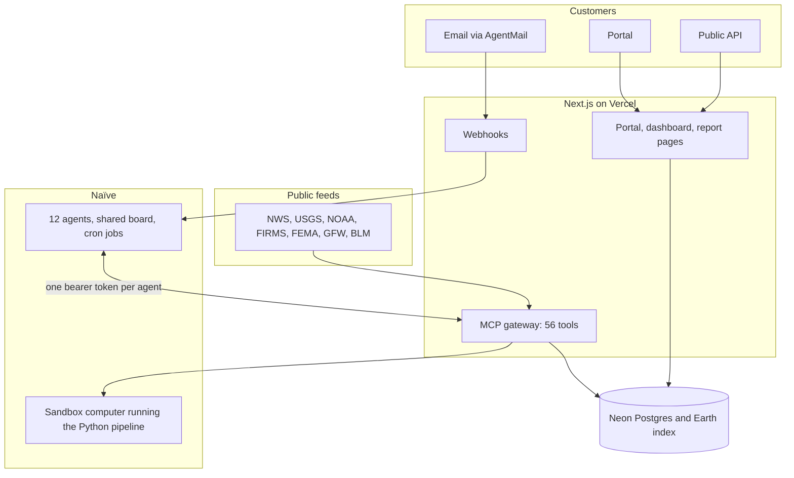

# Terragent

**Ask about any place on Earth, or we'll come to you with the answer.**

Terragent is an Earth intelligence company run by AI agents. Twelve agents take a question about a place, pick the right satellite data, price the job, run the analysis, check the result and email the answer. They also watch public feeds for floods, fires, forest-loss alerts and mining claims, work out which businesses those events affect, and prepare a free analysis of that business's own asset before anyone asks.

Three founders (Aiden, Aarush and Laurence) built it for the [Naïve Autonomous Company Hackathon](https://usenaive.ai/hackathon) at YC in San Francisco, November 7 and 8, 2026. Judges score one thing: how much of the company runs without you.

| | |
|---|---|
| Live site and request portal | <https://terragent.vercel.app> |
| Mission-control dashboard | <https://terragent.vercel.app/dashboard> |
| Scripted demo (replays a real pipeline run) | <https://terragent.vercel.app/demo> |
| Customer inbox | `terragent@agentmail.to` |

Contents: [Why](#why-this-exists) · [Status](#status) · [How it works](#how-it-works) · [Agents](#the-agents) · [Playbooks](#playbooks) · [Data and analysis](#data-and-analysis) · [Pricing](#pricing) · [Safety](#safety-rules-enforced-in-code) · [Surfaces](#surfaces) · [Repo layout](#repo-layout) · [Run it](#run-it-locally) · [Deploy](#deploy-and-provision) · [Spec vs. build](#where-the-build-differs-from-the-spec) · [Roadmap](#not-built) · [Docs](#further-reading)

## Why this exists

Questions about the physical world sit behind dozens of data providers, accounts, minimum orders, licenses, analysts and site visits. Did this property flood? Is this supplier's land deforested? Is this mine expanding? An answer takes days to weeks and costs hundreds to thousands of dollars.

Earlier satellite analytics companies needed human analysts and enterprise sales, so only large contracts paid off. Agents make one custom answer cheap enough to sell to anyone. Imagery marketplaces such as SkyWatch, UP42 and Arlula already exist, and Terragent buys from that layer. Our claim is narrower: the infrastructure exists, and we run a company on it autonomously.

## Status

Snapshot from the production database and Naïve API on **2026-11-08 at 09:55 UTC**, about 50 minutes after the cron jobs went on. The [dashboard](https://terragent.vercel.app/dashboard) has current numbers.

| Spec §10 definition of done | State | Evidence |
|---|---|---|
| 1. Request gets a quote, then a verified report, and lands on the globe | **Working live** | 3 portal requests delivered with verified reports; 373 H3 cells on the globe. The live requests so far came through the portal. Email intake is built. |
| 2. Paid sources compared, real quote request sent, order held | Built, **not yet exercised live** | 4 free-vs-paid decisions logged with reasoning. 0 held orders and 0 supplier emails so far. |
| 3. Signal engine on cron for two or more playbooks | **Running, one playbook has results** | 7 cron jobs scheduled. 52 deforestation signals, 4 prospects, 2 free samples in the pipeline. Disaster and mining sweeps have not stored signals yet. |
| 4. Outbound after template approval; replies route to customer comms | Built, **gated** | Our pipeline has sent 0 touches. Templates are still drafts, and cold email stays blocked until a founder sets a real postal address. See the [outreach note](#outreach-note). |
| 5. Monitoring job re-checks a site and follows up | Built, **not yet exercised live** | Cron scheduled. 0 monitors created. |
| 6. Coordinator shifts effort by measured results | Built, **not yet exercised live** | Cron scheduled. Allocation still at the 50/30/20 default. |
| 7. Dashboard deployed at a public URL | **Done** | Live at the URL above. |
| 8. Market researcher produces a cited price table | Built, **not yet exercised live** | Runs daily at 09:00 Pacific. Table empty so far. |

Other numbers from the same snapshot:

- **Naïve spend:** $5.84 of the $250 credit.
- **Revenue:** $0 collected. Two quotes worth $72 were accepted on requests that [NOTES.md](NOTES.md) records as team test runs.
- **Human interventions logged:** 7, all during live setup testing. The spec's goal is under 10.
- **Median time to answer:** about 14 minutes. The spec's live-demo target is about 2.
- **Tests:** 895 TypeScript tests and 118 Python tests pass; `tsc` is clean.

### Outreach note

An agent set up outside this repo sent 62 cold emails to businesses on 2026-11-08, bypassing the gates described below. The founders disabled its sending and kept its inbox working for replies and opt-outs. [NOTES.md](NOTES.md) has the record. Those sends are not counted in the "0 touches" above.

## How it works



**The gateway is the center of the design.** Naïve's vault can inject a credential only into an MCP connection, so agents never hold database, email or Monid keys. They call narrow tools on our own MCP server ([catalog](src/lib/mcp/catalog.ts)). Each agent has its own token, and the server refuses any tool the catalog doesn't grant that agent. Rules such as price checks and send limits therefore run in server code, where a confused model can't skip them.

### Inbound: a question becomes a report

```mermaid
flowchart LR
    A[Customer asks] --> B[Comms: screens for misuse]
    B --> C[Planner: data spec, checks Earth index]
    C --> D[Acquisition: free first, compares paid]
    D --> E[Pricing: 1 to 3 options]
    E --> F[Comms: sends quote]
    F -->|customer accepts| G[Analytics: runs pipeline]
    G --> H[Interpreter: writes report]
    H --> I[Verifier: grades it]
    I -->|fail, max 2 revisions| H
    I -->|pass| J[Comms: delivers in thread]
    J --> K[Earth index and globe]
```



Planning and source comparison are free, and their output is the quote. Nothing after that runs until the customer accepts an option by email reply, accept link or API call. If the customer picks a paid-data option, the system holds an order for a founder to buy by hand.

Inbound work runs on a direct lane: each handoff starts the next agent's session immediately, so a judge's request doesn't queue behind overnight jobs. Background work (free samples, monitors, follow-ups) runs through cards on the Naïve shared board.

### Outbound: an event becomes a lead

1. **Sourcing** runs on cron, polls feeds for one playbook, and matches events to affected businesses using Naïve's data tools and Monid.
2. It scores each prospect on fit × urgency × ability to pay × reachability, and requests free samples for the top ones.
3. The samples go through the same Planner, Analytics, Interpreter and Verifier stages.
4. **Comms: Outreach** sends each business a specific finding about its own asset, with AI disclosure and an opt-out.
5. Replies land at the customer inbox, where **Comms: Customer** quotes and sells.
6. **Coordinator** reviews metrics every three hours and shifts effort between playbooks.

Cold outreach defaults to the business's own website contact form, because AgentMail's terms forbid cold email. Warm contacts get email. Direct cold email exists in code and stays off unless AgentMail approves it in writing.

### Cron schedule

Seven Naïve deployments, in Pacific time ([naive/deployments.ts](naive/deployments.ts)):

| Job | Agent | When |
|---|---|---|
| Disasters sweep | sourcing | Every 3 hours at :05 |
| Deforestation sweep | sourcing | Every 3 hours at :25 |
| Mining sweep | sourcing | Every 3 hours at :45 |
| Company review and reallocation | coordinator | Every 3 hours at :50 |
| Due monitor re-checks | analytics | Every 6 hours at :35 |
| Follow-ups with new information | comms-outreach | 4 times a day at :15 |
| Market price research | market-researcher | Daily at 09:00 |

## The agents

One Naïve team with a coordinator and a shared board. Definitions live in [naive/agents/](naive/agents/); models and budgets live in [src/lib/config.ts](src/lib/config.ts).

| Agent | Spec name | Job | Model | Window | Cap/day |
|---|---|---|---|---|---|
| `coordinator` | Coordinator | Owns the board, unsticks work, reallocates effort | GLM-5.2-FP8 | loose | $8 |
| `comms-customer` | Comms 2 | Customer inbox: screening, quotes, delivery | Claude Haiku 5.5 | immediate | $8 |
| `comms-suppliers` | Comms 1 | Supplier inbox: quote requests | Claude Haiku 5.5 | immediate | $3 |
| `comms-outreach` | Comms 3 | First touches and follow-ups | Claude Haiku 5.5 | immediate | $8 |
| `planner` | Brain 1 | Turns a question into a data spec | Claude Sonnet 5.5 | immediate | $10 |
| `acquisition` | Orchestrator | Free-first sourcing, paid comparison | Claude Haiku 5.5 | immediate | $10 |
| `pricing` | Pricing | Builds quote options | Claude Haiku 5.5 | immediate | $3 |
| `analytics` | Analytics | Starts analysis jobs and monitor re-checks | Claude Haiku 5.5 | immediate | $10 |
| `interpreter` | Brain 2 | Writes the report | Claude Sonnet 5.5 | immediate | $15 |
| `verifier` | Verifier | Grades reports, blocks weak ones | Claude Sonnet 5.5 | immediate | $8 |
| `sourcing` | Signal engine | Matches events to businesses | GLM-5.2-FP8 | loose | $30 |
| `market-researcher` | Market researcher | Cited table of what alternatives cost | GLM-5.2-FP8 | loose | $6 |

Caps total $119 a day, and the Naïve balance is the hard ceiling. Each agent also has a per-session limit, and each cron run gets its own budget sized to fit the daily cap.

## Playbooks

One engine, four markets. Each playbook is a [Naïve skill](naive/skills/) defining its signals, buyers, data recipe, report format, outreach message and price.

| Playbook | Signal feeds | Buyers | Deliverable |
|---|---|---|---|
| **Disasters and property** | NWS alerts, NOAA NWPS river gauges, NASA FIRMS, USGS earthquakes, OpenFEMA | Property managers, landlords, HOAs, lenders, small insurers | Before/after check, flood or burn extent |
| **Deforestation compliance** | Global Forest Watch alerts, NASA FIRMS | Importers of coffee, cocoa, palm oil, soy, wood, beef, rubber | Forest-loss check of supply regions, with a compliance summary |
| **Mining** | BLM claims, USGS MRDS, company news via Monid | Small miners, prospectors, landowners, governments | Site monitoring and indicators, labeled as indicators and never as deposits |
| **Inbound** | None | Anyone, including other AI agents | A custom answer about any place |

Homeowners and other individuals come through inbound only. Outreach goes to work contacts at businesses.

## Data and analysis

**Free imagery** comes from the Microsoft Planetary Computer: Sentinel-2 L2A at 10 m and Landsat 8/9 at 30 m. Sentinel-1 radar is in the registry as a future option.

**The provider registry** ([db/seeds/providers.ts](db/seeds/providers.ts)) lists 19 sources: 4 free and 15 paid, across optical, radar, thermal and hyperspectral. Paid entries cover SkyWatch, UP42, Planet, Arlula, Vantor and Airbus. Adding a data type means adding a row. The Planner names a data type, and Acquisition picks from the registry.

**The Python pipeline** ([pipeline/terragent_pipeline/](pipeline/terragent_pipeline/)) searches STAC, masks clouds, reads bands, computes indices, renders images, and aggregates results to H3 cells. The backend runs it on a dedicated Naïve computer. A 2×2 km before/after job targets under 60 seconds, with a 75-second deadline that returns a warning in place of a hang. Areas that cross a Sentinel-2 tile edge are read whole, with gaps filled from other tiles of the same satellite pass.

| Recipe | Method |
|---|---|
| `true_color` | RGB image |
| `vegetation_health` | NDVI |
| `flood_extent` | Water index, before vs. after |
| `burn_severity` | NBR and dNBR, in standard severity classes |
| `forest_loss` | NDVI drop against the year before |
| `mining_indicators` | Iron-oxide and clay band ratios |
| `change_detection` | Before/after change against the year before |

Every report carries before and after images, measurements, a confidence level, sources with dates, and limitations.

**The Earth index** is the compounding asset. It stores derived results keyed by H3 cell, date, metric and source (resolution 8 by default, about 0.74 km² per cell). The Planner checks it before fetching anything, and the globe renders it. It never stores raw purchased imagery, because provider licenses forbid resale.

## Pricing

Every job gets its own quote of one to three options, priced bottom-up in [pricing-engine.ts](src/lib/pipeline/pricing-engine.ts):

```
price = data cost + analysis cost + risk buffer + margin
```

- **Data** scales by km², dates and data types.
- **Analysis** starts at about $1.50 of measured agent cost per report.
- **Risk** adds a percentage for new captures, unknown supplier prices and likely clouds.
- **Margin** is 8× analysis cost plus 35% on data and risk, with a $20 floor.
- **Limits:** the cheapest report is $29, quotes last 7 days, and monitoring costs $49 per site per month.

The server recalculates every option an agent proposes. It refuses mismatched data items and any price more than 5% off its own. Free samples for outbound prospects are the one free path, treated as marketing cost.

## Safety rules enforced in code

| Rule | Enforcement |
|---|---|
| Nothing runs before the customer accepts a quote | `assertPriceCleared` on handoffs, analysis jobs, reports, verdicts, delivery and monitors |
| Agents can't set prices | `create_quote` re-prices server-side |
| No data purchase without a founder | `place_paid_order` is the one tool set to `ask`, and it never auto-clears. A founder buys by hand. Naïve has no payment path connected. |
| First email from each inbox needs a founder | `sendEmail` blocks until the inbox is armed |
| Outreach needs an approved template | `templates.status = 'approved'` |
| Opt-outs | Suppression list checked before every send, `/unsubscribe` link, "stop" replies |
| Misuse | Screening refuses stalking, surveillance of individuals and targeting. Refused requests can't advance. |
| No CAPTCHA solving | Browser config sets `solve_captchas: false` and `stealth: false` |
| Deployed key can't charge the card | The app refuses a Naïve key holding `admin` or `billing:write` when running on Vercel |
| Spend limits | Naïve budgets per agent and session, plus caps on Monid, email and free samples |

**One automatic approval you should know about.** Naïve parks tool calls in sessions it flags as having read people's data, even calls set to `allow`, which would stall the unattended pipeline. With `AUTO_APPROVE_GATEWAY_TOOLS=true`, [our policy](src/lib/pipeline/approval-policy.ts) clears parked calls to catalog-allowed gateway tools and to built-ins the agent's own config already allows. It never clears paid orders, raw email sends, wallets, payments, social posting, account signups or vault access. Each clearance is logged as an `approval.auto_allowed` event.

## Surfaces

| Path | What it is |
|---|---|
| `/` | Landing page, interactive globe, request form |
| `/request/[id]` | Customer view of a request's progress |
| `/quote/[token]` | Quote options and accept button |
| `/r/[token]` | Delivered report |
| `/dashboard` | Mission control: globe, funnel, board, decisions, spend vs. revenue, interventions, playbook allocation, sales console |
| `/dashboard/signals` | Signals and outreach detail |
| `/demo` | Replay of a real pipeline run on YC's Dogpatch office |
| `/terms`, `/acceptable-use`, `/unsubscribe` | Legal and opt-out |
| `/api/mcp` | MCP gateway for the agents |
| `/api/webhooks/{agentmail,naive}` | Inbound mail and session events |

### Public API

Software and other agents can ask questions directly. Mint a key with `npx tsx scripts/create-api-key.ts <owner>`. The default limit is 30 requests an hour.

```bash
curl -X POST https://terragent.vercel.app/api/answer \
  -H "Authorization: Bearer $TERRAGENT_API_KEY" \
  -H "Content-Type: application/json" \
  -d '{"question": "How much of this area flooded?", "location": "Folsom Lake, California"}'
```

The call returns `202` with a `request_id` and `status_url`. You can send `lat` and `lon` in place of `location`, plus optional `email` and `callback_url`. Poll `GET /api/answer/{id}`: once a quote is ready, the response includes the options and a ready-made `accept` call.

## Repo layout

```
src/app/            Next.js 16 routes: site, dashboard, API, webhooks
src/components/     Dashboard, report, request and site UI
src/lib/domain.ts   Zod schemas for every hand-off between agents
src/lib/config.ts   Models, budgets, prices, caps
src/lib/mcp/        Gateway: tool catalog, server, tool groups
src/lib/pipeline/   Request lifecycle, pricing, gates, quotes, reports, Earth index
src/lib/outbound/   Prospects, outreach, allocation, monitors, metrics
src/lib/signals/    One file per public feed
src/lib/email/      AgentMail sending, templates, webhook handling
src/lib/naive/      Naïve client, sessions, compute, board
src/lib/imagery/    TypeScript side of scene search and the pipeline
naive/              Agent definitions, playbook skills, cron jobs, provisioning
pipeline/           Python imagery pipeline and its tests
db/migrations/      Plain SQL migrations, run on Neon and PGlite
scripts/            Provisioning, seeding, diagnostics, simulator
docs/platform/      Platform facts verified against SDKs and live calls
video/              Remotion source for the 60-second film
```

**Stack:** Next.js 16, React 19, TypeScript, Tailwind 4, react-globe.gl and Three.js on Vercel. Neon Postgres in production and PGlite locally. Python 3.12+ with Planetary Computer STAC for imagery. Naïve (`@usenaive-sdk/managed-agents`) for agents, AgentMail for email, Monid for business data.

## Run it locally

You need Node 20+. The Python pipeline needs Python 3.12+, and its bootstrap script installs one with `uv` if your system version is older.

The offline mode needs no accounts or keys. It seeds a local PGlite database with demo data and makes no Naïve, AgentMail or Monid calls.

```bash
npm install
```

```bash
npm run dev:local
```

Then open <http://localhost:3000> and <http://localhost:3000/dashboard>.

To walk one request through the whole inbound path with no LLM, no network and no email:

```bash
npx tsx scripts/simulate-request.ts --offline
```

To run the imagery pipeline against real Sentinel-2 data (no key needed):

```bash
bash pipeline/bootstrap.sh
```

```bash
npm run pipeline -- --job job.json --out tmp/out
```

[docs/ARCHITECTURE.md §10](docs/ARCHITECTURE.md) defines the job file format.

### Checks

| Command | Covers |
|---|---|
| `npm test` | Vitest suite, no network or keys |
| `npm run typecheck` | Route types and `tsc` |
| `npm run lint` | ESLint |
| `npm run test:pipeline` | Python pipeline tests |
| `npm run test:live` | `*.live.test.ts`, needs real keys and network |

## Deploy and provision

Agents and webhooks need a public HTTPS URL, because Naïve refuses localhost. Copy `.env.example` to `.env` and fill it in. The main variables are `VETTA_API_KEY` (or `NAIVE_API_KEY`), `AGENTMAIL_API_KEY`, `MONID_API_KEY`, `DATABASE_URL`, `PUBLIC_BASE_URL` and `ADMIN_TOKEN`. Optional tuning values such as `PRICE_*` have defaults in [src/lib/config.ts](src/lib/config.ts).

Use a narrow Naïve key on Vercel, without `admin` or `billing:write`. The deployed app refuses to run with a broader one. Set up the database and Vercel environment first:

```bash
npm run db:migrate
```

```bash
npx tsx scripts/seed-providers.ts
```

```bash
npx tsx scripts/seed-templates.ts
```

```bash
bash scripts/vercel-env.sh
```

Deploy the app to Vercel and set `PUBLIC_BASE_URL` to its production origin. Then provision email and the agents:

```bash
npm run provision:agentmail
```

```bash
npx tsx scripts/provision-agentmail-webhook.ts
```

```bash
npx tsx scripts/provision-naive.ts --dry-run
```

Drop `--dry-run` from the last command to apply it. It creates the skills, agents, per-agent tokens, team, board, pipeline bundle, cron jobs and webhooks, and it is safe to re-run.

Project rules for contributors and coding agents are in [CLAUDE.md](CLAUDE.md).

## Where the build differs from the spec

The [master prompt](terragent-master-prompt.md) was the plan. Where the plan and the platforms disagreed, the platforms won, and [docs/platform/README.md](docs/platform/README.md) lists all 46 discrepancies. The ones that shaped the system:

| Spec said | What we built | Why |
|---|---|---|
| Small quotes auto-approve under a cap | Every quote waits for the customer to accept an option | Founder decision: no free answers |
| Agents email cold prospects from `outreach@` | Contact forms by default; direct email gated | AgentMail's terms forbid cold outreach, and a suspension would also stop customer email |
| Keep third-party keys in the Naïve vault | Keys stay on Vercel behind our MCP gateway | The vault can only inject into MCP connections |
| Analytics runs Python in its own sandbox | The backend runs it on a dedicated Naïve computer | Naïve's people-data flag refuses `bash` in those sessions |
| Verifier uses Naïve outcomes and graders | Verifier is its own agent with image access | Graders have no tools and can't see images |
| Founders approve paid orders and first sends only, with agents otherwise allowed to act | Same rules, plus an automatic policy for parked tool calls | Without it, Naïve's flag stalls every pipeline run |
| USGS flood gauges | NOAA NWPS | USGS's APIs don't carry flood stages |
| Geocode with Monid | Free Census and Nominatim first | Monid money goes to business signals and contacts |
| `@usenaive-sdk/vetta` | `@usenaive-sdk/managed-agents` | The old package name is deprecated |

## Not built

**Stretch goals we skipped:** Mobilerun ground-level dispatch and listing Terragent as a Monid tool.

**Planned:** [NOTES.md](NOTES.md) records a decision to move cold email to a Naïve identity inbox, with AgentMail kept for intake and replies. That change needs a verified domain and isn't in the code yet.

**Out of scope by design (spec §12):** satellite operations, a supplier marketplace, user logins or multi-tenant accounts, any investment, token or securities feature, AI phone calls, native mobile apps, and a general GIS platform.

**Long-term vision (pitch only, no code):** more data types open higher-value buyers, with radar, thermal and hyperspectral next. The company grows in three stages: the cloud (answers on demand), the land (analyzing the Earth proactively to find promising assets), and space (our own satellites, aimed at the gaps our demand data reveals).

## Further reading

| Document | Contents |
|---|---|
| [terragent-master-prompt.md](terragent-master-prompt.md) | The full product and build spec |
| [docs/ARCHITECTURE.md](docs/ARCHITECTURE.md) | Build contract: lanes, flows, tool contract, pipeline CLI |
| [NOTES.md](NOTES.md) | Running log of decisions, spend, founder tasks and interventions |
| [docs/platform/](docs/platform/README.md) | Verified reference for Naïve, AgentMail, Monid, Neon, imagery and signal feeds |
